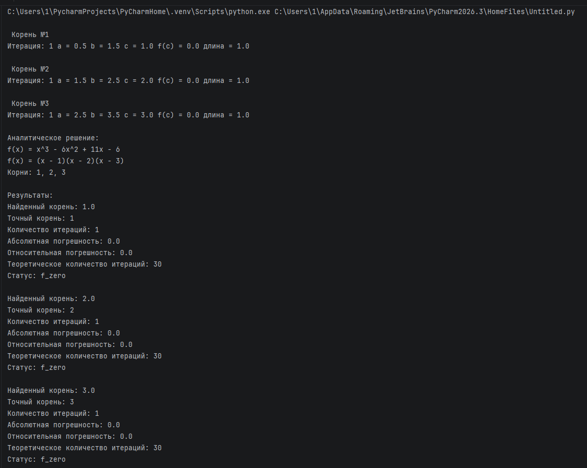

# Результаты

## Задание 1. Поиск корней полинома

Функция: `f(x) = x³ - 6x² + 11x - 6`

### График функции

### Журналы и результаты работы

### Ответы на вопросы

1. Найдены три корня: 1, 2 и 3.
2. Аналитическое решение: `(x - 1)(x - 2)(x - 3) = 0`.
3. Численные результаты совпадают с аналитическими.
4. Абсолютная и относительная погрешности равны 0.
5. Для каждого корня потребовалась одна итерация, потому что середина начального интервала сразу совпала с корнем.
6. Теоретическая оценка составляет 30 итераций, но фактически метод завершился раньше благодаря точному попаданию в корень.