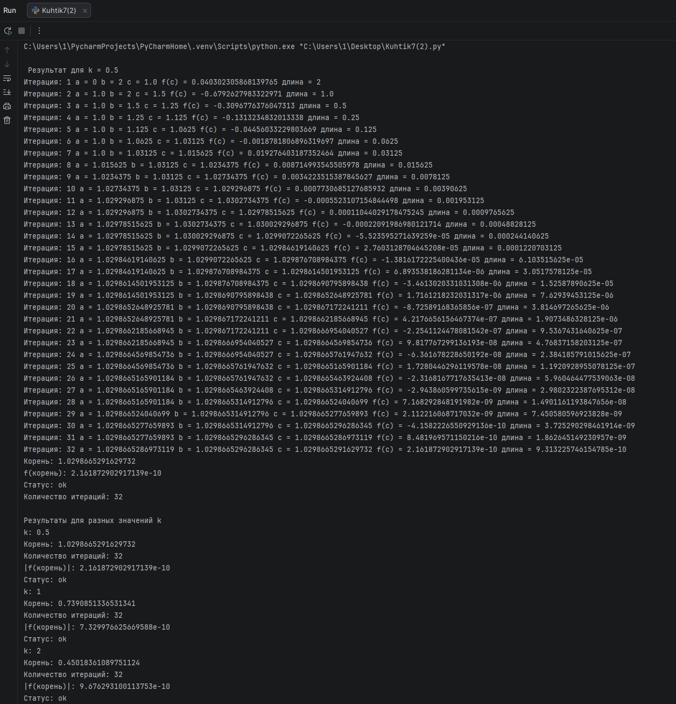
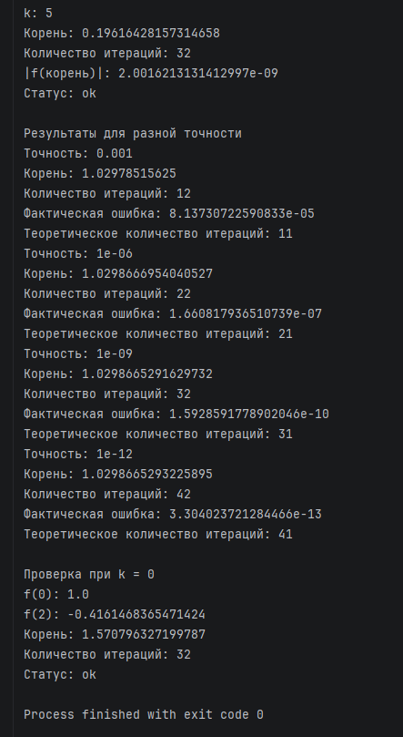
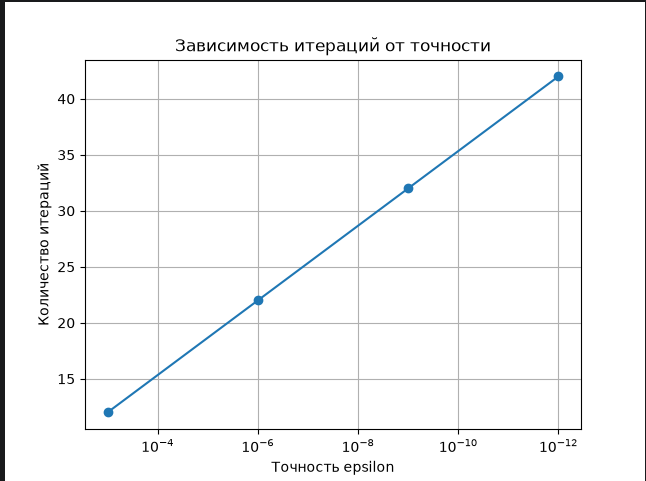

# Результаты

## Задание 2. Бисекция для уравнения с параметром

Функция: `f(x) = cos(x) - k*x`

Начальный интервал: `[0, 2]`

Точность: `1e-9`

### Результаты работы программы

Первая часть вывода:

Вторая часть вывода:

### График зависимости количества итераций от точности ε

### Результаты для разных значений k

- `k = 0.5`: корень ≈ 1.029866529, 32 итерации.
- `k = 1`: корень ≈ 0.739085134, 32 итерации.
- `k = 2`: корень ≈ 0.450183611, 32 итерации.
- `k = 5`: корень ≈ 0.196164282, 32 итерации.

### Результаты для разной точности при k = 0.5

- `ε = 0.001`: 12 итераций.
- `ε = 0.000001`: 22 итерации.
- `ε = 0.000000001`: 32 итерации.
- `ε = 0.000000000001`: 42 итерации.

### Ответы на вопросы

1. При увеличении k корень приближается к нулю.
2. При `k → 0` корень стремится к `π/2`.
3. При `k → ∞` корень стремится к нулю.
4. Чем выше точность, тем больше требуется итераций.
5. При `k = 0` бисекция работает на `[0, 2]`, потому что значения функции на концах имеют разные знаки.
6. При повышении точности количество итераций увеличивается.
7. На каждом шаге длина интервала уменьшается вдвое.
8. Метод бисекции надёжный, но относительно медленный.