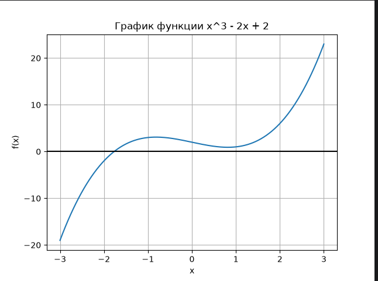
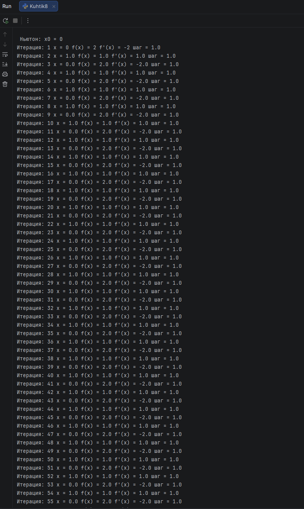
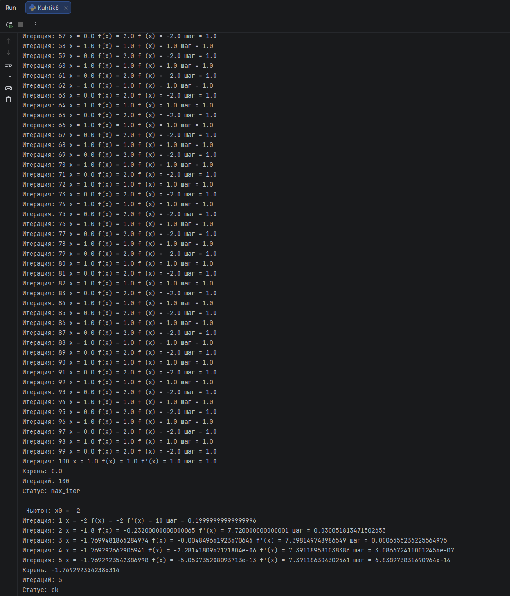
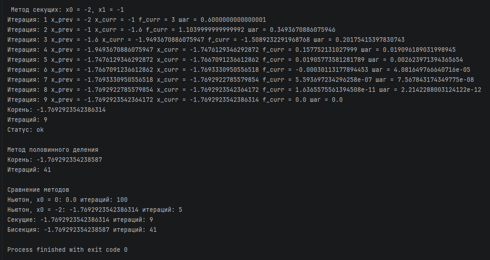

# Результаты

## Задание 1. Сравнение методов на функции с плохим стартом

Функция: `f(x) = x³ - 2x + 2`

Интервал: `[-3, 3]`

### График функции

### Результаты работы программы

Первая часть вывода:

Вторая часть вывода:

Сравнение методов:

### Таблица сравнения методов

| Метод | Начальное приближение | Корень | Итераций |
|---|---|---|---:|
| Ньютон | 0 | Не найден | 100 |
| Ньютон | -2 | -1.769292354 | 5 |
| Секущие | -2, -1 | -1.769292354 | 9 |
| Бисекция | [-2, -1] | -1.769292354 | 41 |

### Ответы на вопросы

1. У функции один действительный корень: примерно `-1.769292354`.
2. При `x₀ = 0` метод Ньютона зацикливается.
3. При `x₀ = -2` метод Ньютона находит корень за 5 итераций.
4. Метод секущих находит корень за 9 итераций.
5. Метод бисекции находит корень за 41 итерацию.
6. Ньютон застревает из-за повторения значений 0 и 1.
7. Начальное приближение влияет на сходимость метода.