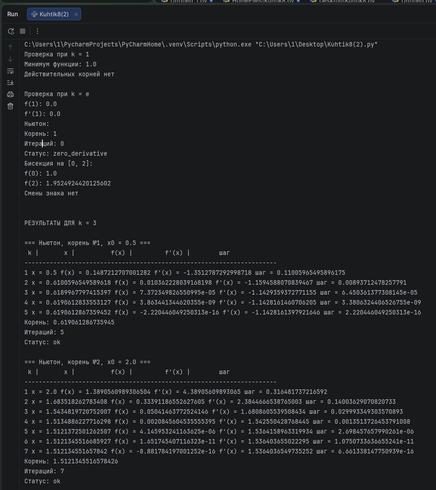
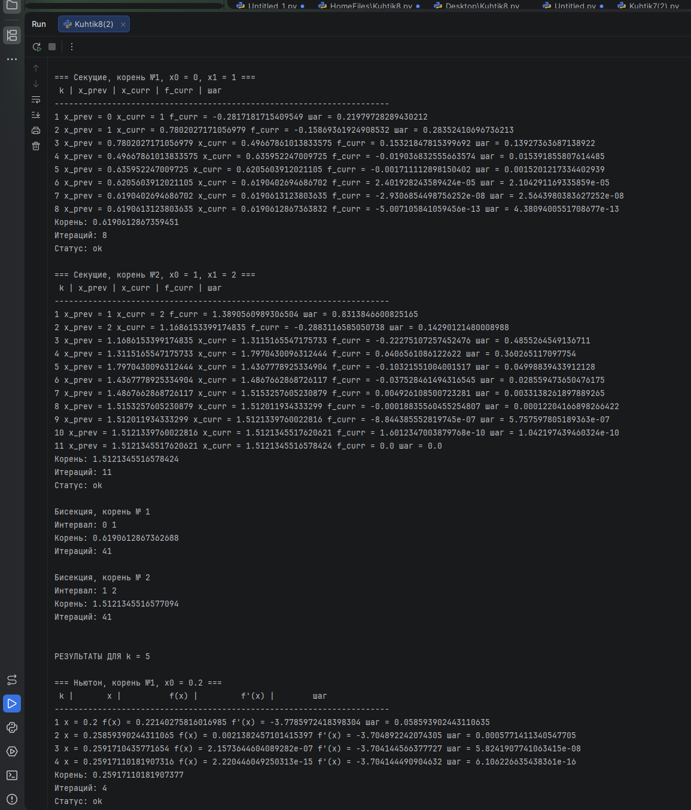
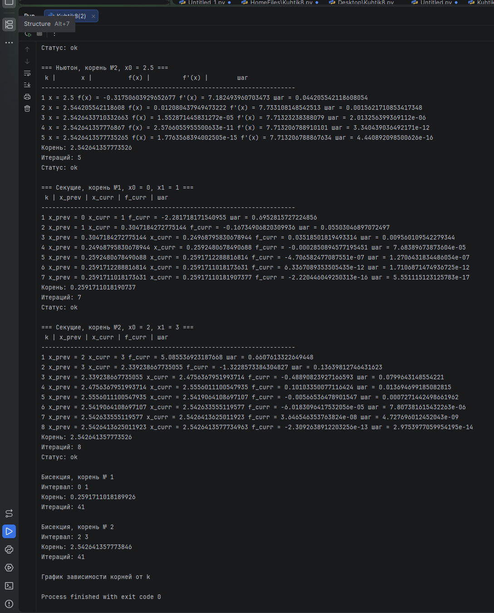
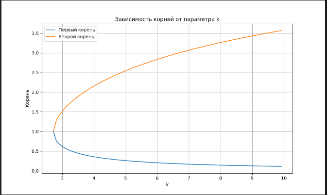

# Результаты

## Задание 2. Уравнение с параметром

Функция: `f(x) = e^x - k*x`

### Результаты работы программы

Первая часть вывода:

Вторая часть вывода:

Третья часть вывода:

### График зависимости корней от параметра k

### Результаты для разных значений k

**При k = 1:**
- Действительных корней нет.

**При k = e:**
- Один корень: `x = 1`.
- График касается оси X.
- Производная в точке корня равна нулю.

**При k = 3:**

| Метод | Корень №1 | Итерации | Корень №2 | Итерации |
|---|---:|---:|---:|---:|
| Ньютон | 0.619061287 | 5 | 1.512134552 | 7 |
| Секущие | 0.619061287 | 8 | 1.512134552 | 11 |
| Бисекция | 0.619061287 | 41 | 1.512134552 | 41 |

**При k = 5:**

| Метод | Корень №1 | Итерации | Корень №2 | Итерации |
|---|---:|---:|---:|---:|
| Ньютон | 0.259171102 | 4 | 2.542641358 | 5 |
| Секущие | 0.259171102 | 7 | 2.542641358 | 8 |
| Бисекция | 0.259171102 | 41 | 2.542641358 | 41 |

### Ответы на вопросы

1. При `k = 1` действительных корней нет.
2. При `k = e` существует один корень `x = 1`.
3. При `k = 3` и `k = 5` существуют два корня.
4. При увеличении k первый корень приближается к нулю, второй увеличивается.
5. При `k → e+` два корня сближаются и стремятся к единице.
6. Ньютон требует меньше итераций, чем секущие и бисекция.
7. Метод бисекции работает медленнее, но надёжен при наличии смены знака.